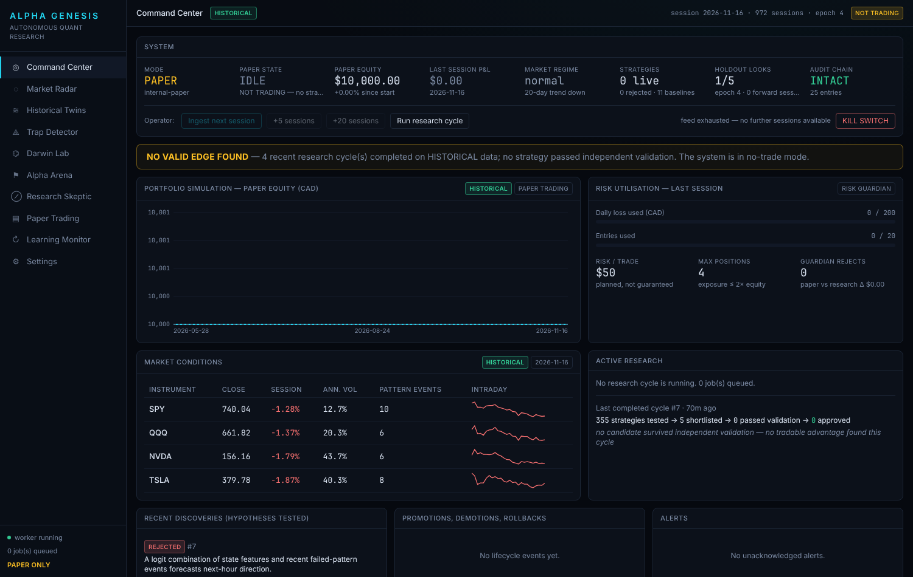
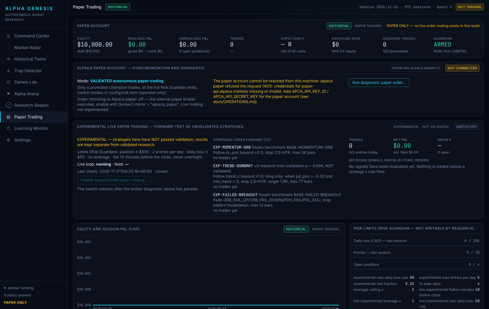
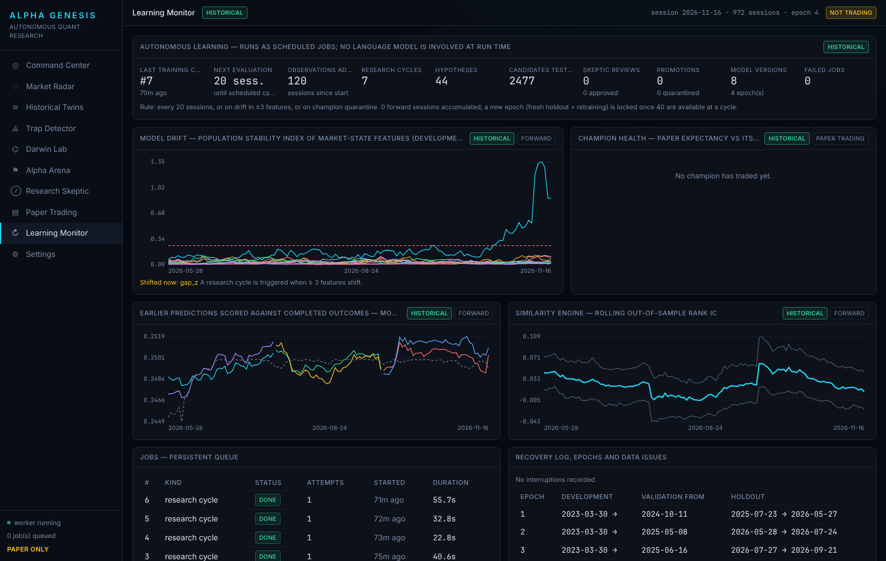

# ALPHA GENESIS on macOS — install, connect Alpaca paper, enable experimental trading

Works on Intel and Apple Silicon (M1–M-series) Macs in principle: everything is Python with native
arm64 packages. **These scripts were written for macOS but have not been run on a Mac** — the build
environment is Linux. The same scripts were exercised on Linux. If a step fails on your Mac, the log
file named below says why.

**Paper trading only.** The app can only talk to `https://paper-api.alpaca.markets`. There is no
real-money code path.

---

## 1. Install and start (about 5 minutes)

1. Install **Python 3.11 or newer** from <https://www.python.org/downloads/macos/> (the universal installer
   runs natively on Apple Silicon). Or with Homebrew: `brew install python@3.12`.
2. Unzip `ALPHA-GENESIS-macOS.zip` somewhere permanent, e.g. your Documents folder.
3. In Finder, **right-click `start-macos.command` → Open → Open**. (A plain double-click is blocked the
   first time because the file came from the internet. If macOS still refuses, open Terminal and run the
   two commands under "Terminal alternative" below.)
4. A Terminal window installs the app into a private `.venv` folder, creates your `.env` file and opens
   it in TextEdit.
5. Paste your **Alpaca paper** keys (section 2), save, close TextEdit, and open `start-macos.command`
   again. To look around first without keys, leave `.env` unchanged: the app runs an offline demo on
   clearly labelled synthetic data.
6. Your browser opens the dashboard at **<http://127.0.0.1:8000>**.



**Terminal alternative**

```bash
cd ~/Documents/ALPHA-GENESIS-macOS && xattr -dr com.apple.quarantine . && chmod +x *.command scripts/*.sh
```

```bash
./start-macos.command
```

| Action | How |
| --- | --- |
| Start | `start-macos.command` |
| Stop | `stop-macos.command` |
| Keep running after restarts, restart itself if it stops | `install-macos-autostart.command` (uses launchd; undo with `uninstall-macos-autostart.command`) |
| Dashboard | <http://127.0.0.1:8000> |
| Log | `logs/alpha-genesis.log` (structured, one JSON line per event) |
| Your data (database, price history, models) | `data/` — survives restarts and updates; back it up from Settings |

One process runs everything together: dashboard, API, database, research worker, the scheduler for the
daily learning pipeline, and the live paper-trading loop. Your Mac must be **awake** during market hours
for live trading and after the close for the daily research run (System Settings → Battery/Energy →
prevent automatic sleeping while plugged in).

The first start with Alpaca keys downloads about four years of 5-minute history and builds the research
state. Expect several minutes before the dashboard appears; the Terminal window shows progress.

**Docker instead (optional):** install Docker Desktop for Mac (Apple Silicon build), then
`docker compose up --build -d` in the unzipped folder. The image is `python:3.12-slim`, which Docker
pulls as `linux/arm64` on Apple Silicon; no emulation is needed. The Docker image has not been built in
the development environment.

---

## 2. Connect your Alpaca paper account

1. Sign in at <https://app.alpaca.markets>, switch the account selector (top left) to **Paper**, and
   under *API Keys* generate a key pair. If your keys were ever pasted into a chat or e-mail, regenerate
   them first.
2. Put them in `.env` in the app folder (TextEdit: `open -e .env`):

   ```
   APCA_API_KEY_ID=your-paper-key-id
   APCA_API_SECRET_KEY=your-paper-secret
   ```

   `.env` is ignored by git and set to be readable only by you. Cloud secrets from any online coding
   session do **not** exist on your Mac; this file is the only place the app reads keys from.
3. Stop and start the app.
4. Open **Paper Trading**. The *Alpaca paper account* panel should say **connected** and show account
   status, equity, buying power, positions and recent orders, plus whether the broker's positions match
   the app's own book.
5. Click **Run diagnostic paper order…** and confirm. The app sends one buy-1-share **limit order at
   $1.00** (it cannot fill), reads it back, cancels it, and re-checks positions. Each step shows pass or
   fail. Nothing is sent until you confirm.



If the panel says *not connected (401)*: the keys are wrong, belong to the live account, or were
regenerated. Paper keys start with `PK`.

---

## 3. Enable experimental paper trading

This mode forward-tests three strategies that have **not** passed validation (the research found no
valid edge; see `docs/V3_REPORT.md`). Expect small losses. It exists to collect genuine forward evidence,
not because anything is believed to work.

1. Pass the diagnostic (section 2). The switch stays locked until then.
2. In **Paper Trading → EXPERIMENTAL live paper trading**, click **Enable experimental paper trading…**
   and confirm.
3. From then on, during regular US market hours and without any further prompts, the app:
   - reads each completed 5-minute bar from the fastest feed your Alpaca plan allows (real-time SIP if you
     subscribe to it, otherwise real-time IEX — it tries SIP, records the refusal, and uses IEX);
   - evaluates the three strategies and sends eligible signals to the Risk Guardian;
   - submits approved orders to your Alpaca **paper** account as market orders, tracks fills, manages
     stops, targets and time exits, and closes everything 10 minutes before the close;
   - records every signal, risk decision, order, fill and P&L, shown in the same panel.

| Limit (enforced by the Risk Guardian, set in `config/risk.toml`) | Value |
| --- | --- |
| Maximum position | CAD 500 notional |
| New entries per day | 2 |
| Planned daily loss | CAD 50 (new entries stop and open positions are closed) |
| Leverage | none |
| Overnight positions | never |
| Short sales | whole shares only (so only instruments priced under about USD 350) |

It suspends itself, and says why, on stale market data, three consecutive broker or data errors, a
position mismatch with the broker, or the kill switch. If no rule fires, **no order is sent** — a quiet
day is a correct outcome. Turn it off with **Turn switch off**; close positions with **Close all
experimental positions**.

Things to know before relying on it:

- Stops are watched by the app on completed 5-minute bars, not held at the broker. If the app or your Mac
  stops while a position is open, that position has no stop until the app is running again. Fractional
  orders are the reason: Alpaca's bracket orders need whole shares, and CAD 500 buys less than one share
  of SPY.
- On the IEX feed, strategies that need consolidated volume are excluded automatically. The three shipped
  strategies use price only. IEX bars are built from IEX trades alone, so highs, lows and ranges can
  differ slightly from the consolidated tape the research used.
- Experimental results are stored separately and never count as validation.

---

## 4. Autonomous learning

After each session's close the scheduler ingests the day's consolidated bars, checks data quality, scores
earlier predictions, measures drift, reviews experimental trades, re-runs the tournament, and every 20
sessions (or on drift) runs a research cycle; every 40 new sessions it locks a fresh holdout and retrains.
A strategy is promoted to **validated** paper trading only after passing the Research Skeptic and a shadow
period. Losing experimental strategies are turned into new research hypotheses. Progress is on the
**Learning Monitor** screen.



---

## 5. What has and has not been verified

| | Status |
| --- | --- |
| Research engines, risk controls, restart recovery | 153+ automated tests on Linux |
| Live experimental pipeline (data → signal → risk → order → fill → reconciliation → records) | tested against **simulated** Alpaca data and paper APIs, including restarts, stale data, broker outages and mismatches |
| Real Alpaca market data (historical, SIP) | verified live on 2026-11-17 |
| Real Alpaca **paper** account | **not verified** — the build environment's saved keys were rejected (HTTP 401) on the day of this release |
| Real-time feed entitlement (SIP vs IEX) on your plan | **not verified** — the app checks and reports it on first use |
| macOS scripts, launchd auto-start, Apple Silicon | **not run on a Mac** |
| Docker image | not built |
